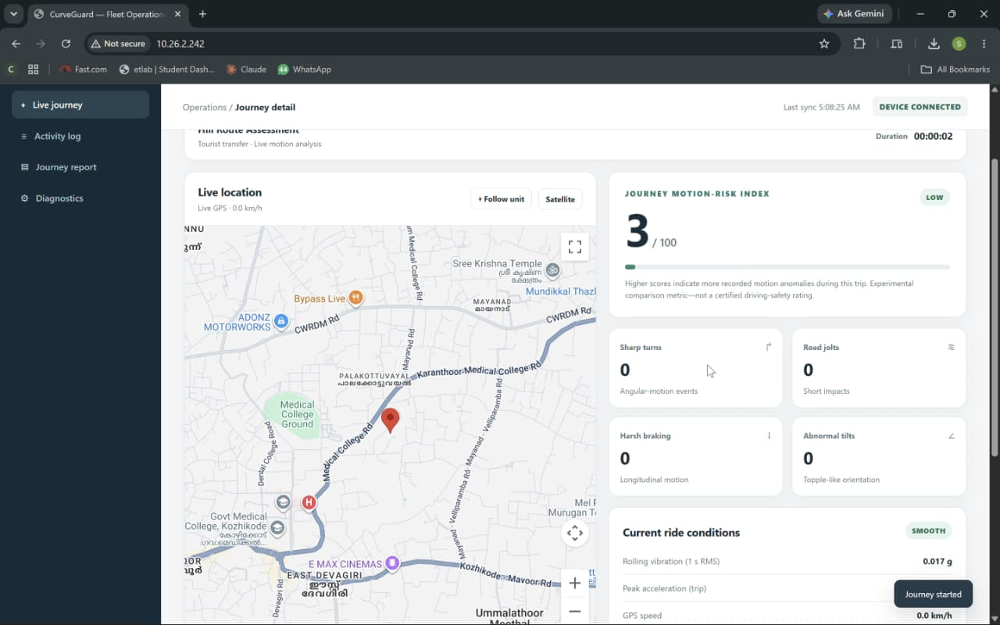
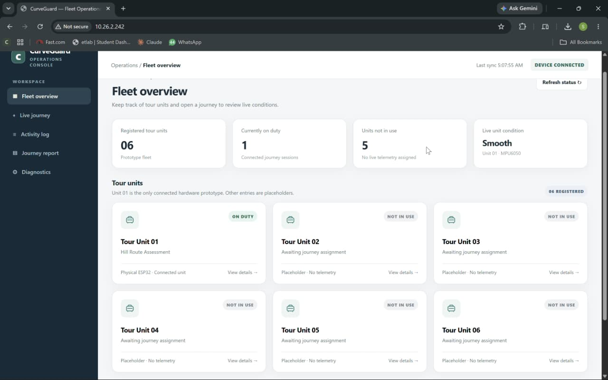
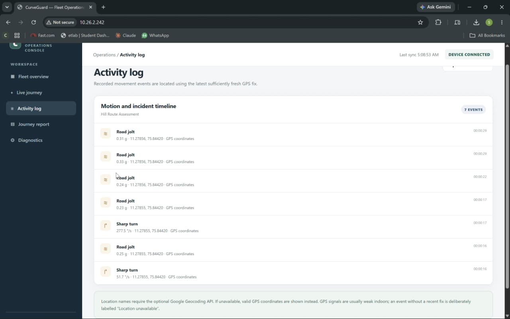
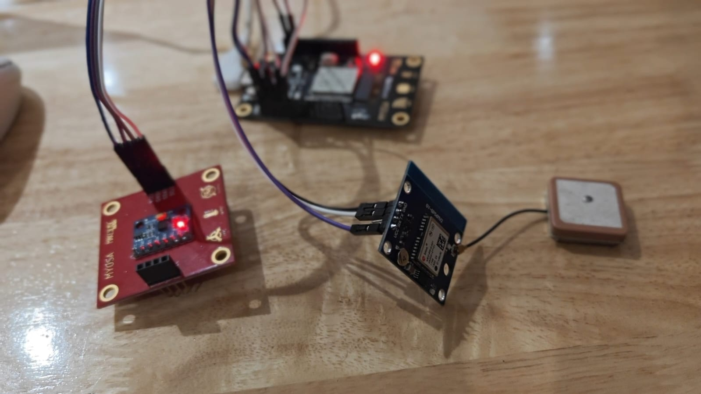
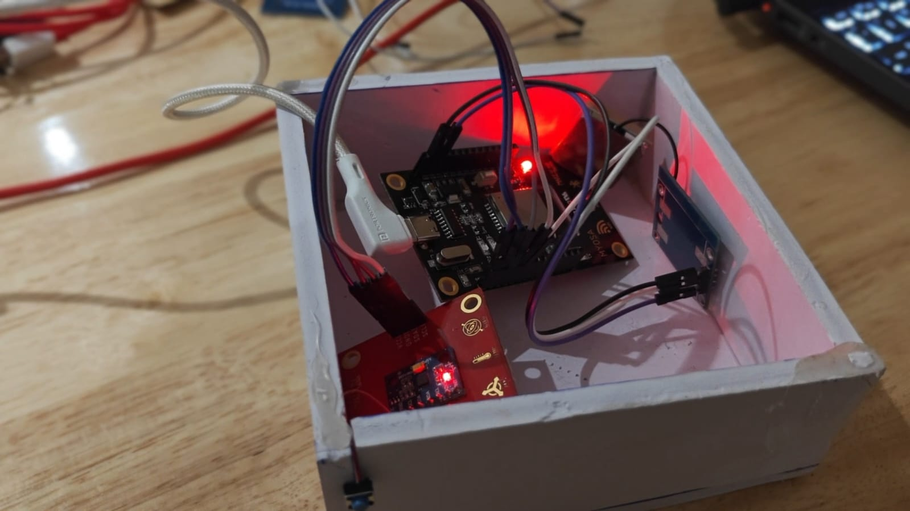
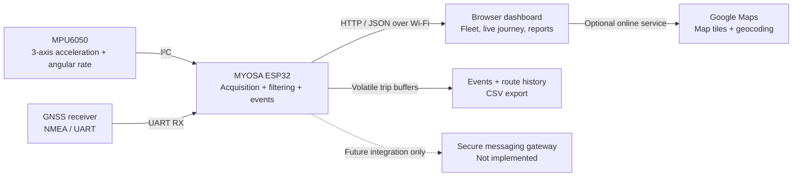

<div align="center">

# CurveGuard

### Intelligent Vehicle Motion Monitoring & Fleet Journey Assurance

**An ESP32-based system for measuring journey motion, recording unusual driving events, and visualizing GPS-linked trip information through a live fleet dashboard.**

**TinkerHub LAYOVER Hackathon 2026 · Embedded Systems · IoT · GNSS · Vehicle Telemetry**

</div>



> [!IMPORTANT]
> **Prototype status:** CurveGuard is an experimental, non-certified vehicle-motion monitoring demonstrator. The uploaded firmware and screenshots show one connected ESP32 prototype and five *UI-only fleet placeholders*. Its emergency banner is **local to the dashboard**; it does **not** send SMS, notify emergency responders, confirm a collision, or control the vehicle.

## Table of contents

- [Overview](#overview)
- [The problem](#the-problem)
- [What CurveGuard does](#what-curveguard-does)
- [Prototype gallery](#prototype-gallery)
- [System architecture](#system-architecture)
- [Hardware and wiring](#hardware-and-wiring)
- [Firmware and motion processing](#firmware-and-motion-processing)
- [Journey motion-risk index](#journey-motion-risk-index)
- [Fleet operations dashboard](#fleet-operations-dashboard)
- [Getting started](#getting-started)
- [HTTP API](#http-api)
- [GPS and sensor troubleshooting](#gps-and-sensor-troubleshooting)
- [Demonstration procedure](#demonstration-procedure)
- [Implementation status and roadmap](#implementation-status-and-roadmap)
- [Safety, privacy, and security](#safety-privacy-and-security)
- [Project context](#project-context)

## Overview

**CurveGuard** is a compact, vehicle-mounted monitoring prototype that combines a **six-axis MPU6050 inertial measurement unit (IMU)**, a **GNSS/GPS receiver**, and an **ESP32 microcontroller**. The ESP32 samples motion, detects configured event patterns, receives positioning data, and hosts a browser-accessible operations dashboard on the local Wi-Fi network.

It is designed around a practical question: **Can a low-cost, independent device make unusual vehicle motion visible to a tour or fleet operator, rather than relying entirely on passenger complaints or passive location tracking?**

The current prototype focuses on **observability**: measuring movement, identifying candidate maneuvers, organizing data by journey, and showing event context. Automatic emergency messaging and production vehicle deployment are later-stage goals.

### At a glance

| Area | Current prototype |
| --- | --- |
| Main controller | MYOSA ESP32-WROOM-32E / compatible ESP32 |
| Motion sensing | MPU6050, 3-axis accelerometer + 3-axis gyroscope |
| Positioning | UART GNSS receiver (GY-GPS6MV2/NEO-6M-class breakout) |
| Motion sampling | Target interval: **10 ms (~100 Hz)** |
| Connectivity | 2.4 GHz Wi-Fi station; fallback ESP32 access point |
| Interface | Responsive HTML/CSS/JavaScript hosted by the ESP32 |
| Mapping | Google Maps JavaScript API (separate internet/API configuration) |
| Journey metrics | Turn, jolt, braking, tilt, rolling vibration, peak motion, experimental risk index |
| Event data | In-memory timeline, GPS annotation when fresh, CSV export |
| Fleet representation | **1 real connected unit + 5 illustrative placeholders** |
| Emergency behavior | On-screen local incident overlay + manual test mode; **no external dispatch** |

## The problem

Tourist transfers, chartered buses, tempo travellers, and other passenger vehicles may encounter winding roads, sudden turns, rough surfaces, abrupt deceleration, or abnormal tilts. GPS tracking indicates **where** a vehicle is, but not necessarily **how the ride feels or what motion events occurred** along the way.

CurveGuard explores an additional telemetry layer:

1. Measure vehicle-mounted motion continuously.
2. Identify candidate unusual maneuvers using transparent thresholds.
3. Associate recorded events with a sufficiently recent GPS location.
4. Present trip summaries, a timeline, and live conditions to an operator.
5. Provide a foundation for carefully validated incident response in later versions.

A single IMU cannot determine driver fault, prove an accident, or predict an unseen road curve. CurveGuard reports **observed motion**, not a certified driving-safety judgment.

## What CurveGuard does

| Feature | Description | Status |
| --- | --- | --- |
| Live acceleration and rotation | Reads 3-axis accelerometer and gyro values | Implemented in firmware |
| Motion classification | Detects sustained high yaw rate, jolts, relative tilt, and a braking proxy | Implemented; thresholds are experimental |
| Journey sessions | Start/end a trip and reset trip-specific counters | Implemented |
| Trip profiles | Separate default sensitivity for **road** and **off-road** | Implemented |
| GNSS diagnostics | UART auto-baud scanning, NMEA checksum counters, RMC/GGA parsing | Implemented in firmware |
| Live GPS | Shows speed and valid/recent location when available | Implemented; outdoor performance depends on GNSS reception |
| Interactive map | Live position, route trail, event markers, follow and satellite views | Implemented UI; requires working Google Maps API access |
| Motion-risk index | Per-trip experimental score (0–100) | Implemented; **not** a validated safety score |
| Fleet overview | Operations interface with six unit cards | Implemented UI; **only Unit 01 has hardware** |
| Event timeline | Recent events with type, magnitude, time, and available coordinates | Implemented |
| CSV export | Exports recorded trip events from the ESP32 | Implemented |
| Diagnostics and calibration | IMU status, I²C scan, GPS counters, adjustable thresholds | Implemented |
| Local incident overlay | Displays elevated tilt/impact-supported incident and simulated incident alerts | Implemented; not external SOS |
| Automatic SMS, GSM or emergency calls | External messaging to configured contacts | **Not implemented** |
| Validated crash detection | Real-world accident detection and false-alarm certification | **Not implemented** |
| Cloud fleet backend | Multiple physical devices, historical cloud storage, authentication | **Not implemented** |

## Prototype gallery

### Fleet overview

One connected tour unit is shown alongside five UI placeholders for a possible future multi-vehicle implementation.



### Live journey and location

The active trip view combines GPS location, a map, motion-risk index, event counters, and current ride conditions.


### Activity log

Motion events appear with their measured magnitude, journey-relative timestamp, and GPS coordinates **only when an adequately fresh fix is available**.



### Hardware prototype

| Connected sensors | Enclosed bench prototype |
| --- | --- |
|  |  |

*Photographs document the hackathon prototype and wiring. The enclosure and jumper connections are not automotive-certified installation hardware.*

## System architecture



**Processing stays on the ESP32.** The IMU and GNSS do not require an FPGA, Raspberry Pi, external computer, or cloud server for basic local telemetry. A connected browser receives JSON over the local network. **The map is an exception:** Google Maps loading and geocoding require valid API authorization and suitable internet access.

### Main data flow

```text
MPU6050 --I2C--> raw ax, ay, az / gx, gy, gz
                        |
                        v
              calibration + filters
                        |
             +----------+------------+
             |          |            |
             v          v            v
           turns       jolts    tilt / brake proxy
             |          |            |
             +----------+------------+
                        |
               journey event buffer ----- CSV export
                        |                       |
GNSS --UART--> NMEA checksum / RMC / GGA     |
                        |                       |
              fresh position / speed ----------+
                        |
               ESP32 HTTP JSON API
                        |
               Fleet dashboard + map
```

## Hardware and wiring

### Components

- **ESP32 / MYOSA ESP32-WROOM-32E** board with Wi-Fi.
- **MPU6050** accelerometer/gyroscope breakout.
- **GNSS module** with antenna, supplied as a GY-GPS6MV2/NEO-6M-class breakout.
- Jumper wires, a stable USB supply, and a non-conductive demonstration enclosure.
- Laptop or phone on the same Wi-Fi network to access the dashboard.

### MYOSA connections used by the uploaded V4 sketch

The labels below match the project's **MYOSA board mapping**, not a generic ESP32 default pin diagram.

| Device | Signal | ESP32 / MYOSA label | Notes |
| --- | --- | --- | --- |
| MPU6050 | VCC | **3V3** | Use the sensor breakout's supported supply voltage |
| MPU6050 | GND | **GND** | Common ground |
| MPU6050 | SDA | **D4 / GPIO4** | I²C data |
| MPU6050 | SCL | **D16 / GPIO16** | I²C clock |
| GPS module | TX | **D17 / GPIO17** | GPS TX **→** ESP32 receive pin |
| GPS module | GND | **GND** | Must share ground with ESP32 |
| GPS module | VCC | **Per breakout specification** | Confirm whether its board supports 3.3 V or 5 V input |
| GPS module | RX | Not connected | Current sketch only receives NMEA data |

> [!NOTE]
> `D4`, `D16`, and `D17` refer to physical board labels as discussed for the MYOSA board. Verify actual pin exposure and GPIO correspondence on your board revision. **Do not assume GPIO21/22 or standard DevKit pin labels match this wiring.** The MPU6050's SCL uses GPIO16, so GPS cannot simultaneously use GPIO16 as its receive input in this build.

```text
ESP32 / MYOSA
  3V3 ---------------- MPU6050 VCC
  GND ----+----------- MPU6050 GND
          +----------- GPS GND
  D4  / GPIO4 ------- MPU6050 SDA
  D16 / GPIO16 ------ MPU6050 SCL
  D17 / GPIO17 <----- GPS TX
  GPS VCC ----------- breakout-approved regulated supply
```

**Mounting matters:** yaw and braking heuristics assume a consistent device orientation. The sketch's sharp-turn logic expects the sensor's **Z axis approximately vertical**. The braking proxy assumes **sensor +X faces vehicle forward**. A loose or hand-held device cannot generate meaningful vehicle-level driving metrics.

## Firmware and motion processing

The uploaded sketch, `CurveGaurd-Layover.ino`, identifies itself as **CurveGuard Fleet Operations V4.0 (Sensor Diagnostics)**. It uses the Arduino-ESP32 core's `WiFi.h`, `WebServer.h`, `Wire.h`, and `HardwareSerial.h` facilities; its NMEA parser is written directly in C++ and **does not need TinyGPS++**.

The dashboard HTML/CSS/JavaScript is stored as **gzip-compressed bytes in flash (`PROGMEM`)** and delivered by the ESP32 web server. This avoids needing a separately hosted frontend or SPIFFS upload for the supplied build.

### Signal processing

- The sketch targets a **10 ms sampling period (~100 Hz)**.
- MPU6050 accelerometer full-scale is set to **±8 g** and gyro to **±500°/s**.
- Startup calibration gathers stationary readings to estimate gyro bias and an initial upright reference.
- A smoothed Z-axis angular rate is used as a **yaw-rate proxy**.
- A low-pass estimate of gravity is subtracted from measured acceleration to estimate short-term dynamic motion.
- A **100-sample rolling RMS** of dynamic acceleration helps classify current ride conditions.
- The angle between the gravity estimate and calibrated reference provides **relative tilt**, rather than an absolute road-banking measurement.
- Detectors use hold times, hysteresis/latching, and event cooldowns to reduce repeated triggers.

The firmware also performs an I²C scan, checks compatible IMU addresses (`0x68`/`0x69`), reports `WHO_AM_I`, and distinguishes a missing sensor from a sensor that is present but could not be calibrated while stationary.

### Default event logic

The values below are **demonstration thresholds coded in the supplied firmware**, not legal, clinical, automotive, or passenger-comfort standards.

| Event / metric | Default road profile | Detection behavior |
| --- | --- | --- |
| Sharp turn | **40°/s** | Absolute smoothed sensor Z yaw rate sustained **150 ms** |
| Road jolt | **0.23 g** | Short dynamic-acceleration excursion (at least ~10 ms); **850 ms** cooldown |
| Braking proxy | **0.33 g** | Negative sensor-X dynamic acceleration sustained **130 ms** |
| Abnormal tilt | **55°** | Relative tilt sustained **350 ms**, with re-arming below a lower threshold |
| Current ride condition | RMS bands: **0.050 g**, **0.145 g** | Classifies smooth, moderate, or rough motion |
| Incident support | **2.8 g** impact-like dynamic acceleration | If a subsequent abnormal tilt occurs within **3 s**, raise a local incident indicator |

The **off-road profile** adjusts its defaults, including a **58°/s** turn threshold, **0.43 g** jolt threshold, **0.48 g** braking proxy, and higher rolling-RMS bands. The UI also allows editing turn, jolt, and tilt thresholds during operation.

**Caution:** A local incident can also be raised for sustained abnormal tilt *without* an impact-like event. Neither condition establishes that a real vehicle collision occurred.

### GPS parsing and location freshness

The firmware receives GNSS NMEA on `GPS_RX_PIN = 17`, initially trying **9600 baud**, then scanning common rates **4800, 19200, 38400, 57600, and 115200** until a checksum-valid NMEA sentence is found. It parses **RMC** for coordinates/speed and **GGA** for satellite and HDOP information.

- **Fresh GPS fix:** most recent valid RMC position is less than **6 seconds** old.
- **Event geotagging:** coordinates are added only when a fresh fix exists.
- **Route buffer:** retains up to **240 points** in RAM, capturing points after sufficient movement or elapsed time.
- **Diagnostics:** received bytes, valid/invalid sentences, baud lock, RMC/GGA counts, satellite count, fix freshness, and location age.

A satellite receiver may output valid NMEA without a location fix. For repeatable fixes, test with the antenna outdoors and with a clear view of the sky.

## Journey motion-risk index

The dashboard shows an experimental **Journey Motion-Risk Index from 0 to 100**. It increases with observed vibration and detected events during the current trip; it is **not a certified driver score or accident probability**.

The current firmware calculates:

```text
trip_minutes = max(1, trip_elapsed_ms / 60000)
mean_rms     = average of per-sample rolling dynamic-acceleration RMS (g)

motion_term  = min(35, 170 * mean_rms)
event_term   = (4*turns + 6*jolts + 6*brakes + 20*tilts) / trip_minutes

risk_index   = clamp(motion_term + event_term, 0, 100)
```

The current dashboard presents example bands: **Low (below 25)**, **Elevated (25 to below 55)**, and **High (55 and above)**. These are **interface labels for a research/demo heuristic**, not validated limits.

This score uses IMU-derived motion and event counts. **GPS speed is shown separately; the V4 risk formula does not yet incorporate speed-aware cornering severity, road geometry, or individual vehicle calibration.**

## Fleet operations dashboard

The ESP32 serves a multi-page operations interface designed for a tour/fleet coordinator:

| Screen | What it displays |
| --- | --- |
| **Fleet overview** | Registered unit cards, on-duty count, prototype connectivity, current unit condition |
| **Live journey** | GPS map, route trail, risk index, sharp turns, jolts, braking, abnormal tilt, vibration, speed |
| **Activity log** | Timestamped event list, measured magnitudes, optional GPS coordinates, CSV export |
| **Journey report** | Journey-specific summary, duration, event totals, measured motion, CSV download |
| **Diagnostics** | IMU/GPS health, I²C status, NMEA counts, calibration, thresholds, incident simulation |

**Fleet caveat:** The six cards illustrate how an operator interface might look. At present, **only Tour Unit 01 represents real ESP32 telemetry; Tours 02–06 are labeled placeholders**. This is *not* a live multi-device cloud fleet deployment.

A local operator alert overlay appears when the firmware raises an abnormal-tilt / incident indicator. The Diagnostics screen can also **simulate** an incident for judging and verification; the simulation is labeled and can be acknowledged on-screen.

## Getting started

### 1. Software requirements

- Arduino IDE 2.x (or a compatible Arduino build environment).
- Espressif **ESP32 Arduino board package** installed via Boards Manager.
- A supported ESP32 board definition, such as **ESP32 Dev Module**, if appropriate for the actual MYOSA controller.
- The project's `.ino` firmware.
- USB data cable and the appropriate USB-serial driver for your board.

The **uploaded V4 source** relies only on ESP32-core libraries; no additional TinyGPS++ library is required for this version.

### 2. Connect the sensors

Wire the MPU6050 and GPS exactly as shown in [Hardware and wiring](#hardware-and-wiring). Confirm common ground and sensor supply ratings. Keep the MPU6050 still at startup for its upright calibration.

### 3. Configure network and map access

The V4 sketch contains Wi-Fi station and fallback-access-point configuration values near the beginning of the file. Before flashing, configure them for **your own private network**:

```cpp
// Example values only. Do not commit real credentials.
static const char *WIFI_SSID = "YOUR_2_4_GHZ_WIFI";
static const char *WIFI_PASSWORD = "YOUR_PRIVATE_PASSWORD";
```

If the configured hotspot is unavailable during startup, the firmware creates a local fallback access point. Set a **unique strong fallback password** before any real deployment.

For Google Maps, the HTML embedded in this particular sketch contains a **Google Maps JavaScript API key**. The dashboard can show local IMU/GPS values without Google Maps, but the interactive map needs a **valid, billing-configured and appropriately restricted key** plus access to the Google Maps service. **Do not copy a key from screenshots or another project's source.**

> [!WARNING]
> **Before making the firmware public:** the uploaded prototype `.ino` contains a real Wi-Fi password and an embedded Google Maps API key. **Rotate the Wi-Fi password and review/restrict or replace the Maps key** before publication. Move secrets out of tracked source files, and inspect Git history if those values have already been committed. Merely hiding a key in gzip data does **not** protect it.

### 4. Flash firmware

1. Open the `.ino` project in Arduino IDE.
2. Select the correct ESP32 board and COM/serial port.
3. Compile and upload the sketch.
4. Open **Serial Monitor at 115200 baud**.
5. Confirm that the IMU scan, GNSS baud tests, Wi-Fi connection, and local HTTP server initialize.

Expected diagnostics include messages resembling:

```text
CurveGuard Fleet Operations V4.0 (Sensor Diagnostics)
I2C: SDA GPIO4 (D4), SCL GPIO16 (D16)
[MPU] ONLINE addr=0x68 ...
[GPS] Trying UART baud 9600 on D17/GPIO17
OPEN DASHBOARD: http://<ESP32_IP>/
HTTP server ready. No extra Arduino libraries required.
```

The exact IMU address, GPS baud, and local IP may differ. A GPS baud scan does **not** by itself mean that satellites have been acquired.

### 5. Open the dashboard

Connect a phone or laptop to the same local Wi-Fi network as the ESP32 (or to its fallback access point), then enter the IP address printed in Serial Monitor:

```text
http://<ESP32_IP>/
```

Select **Tour Unit 01**, start a journey, and choose either `road` or `offroad`. During a test, watch live sensor readings and trigger gentle, controlled motion events. Use **Journey report** and **Activity log** to inspect or export collected events.

**No public internet is necessary for the local ESP32 telemetry/dashboard pages; internet access is needed to load Google's map resources.**

## HTTP API

The firmware hosts an HTTP server on **port 80**. The UI polls `/api/state` (approximately every 600 ms while the page is visible) and fetches history/route data as revisions change.

| Method | Endpoint | Purpose |
| --- | --- | --- |
| `GET` | `/` | Serve compressed dashboard |
| `GET` | `/api/state` | IMU, GNSS, network, trip, statistics, motion and incident status |
| `GET` | `/api/events` | Recent event records (up to 64 retained) |
| `GET` | `/api/route` | GPS route samples (up to 240 retained) |
| `GET` | `/api/events.csv` | Download event log as CSV |
| `POST` | `/api/start` | Begin journey with `name` and `profile=road/offroad` |
| `POST` | `/api/end` | End active journey |
| `POST` | `/api/clear` | Clear event history and counters |
| `POST` | `/api/calibrate` | Calibrate sensor upright reference while still |
| `POST` | `/api/settings` | Change `turn`, `jolt`, and `tilt` thresholds |
| `POST` | `/api/defaults` | Restore current profile defaults |
| `POST` | `/api/simulate` | Generate a **local test incident** in an active journey |
| `POST` | `/api/ack` | Acknowledge/clear local incident indicator |

**Example request (from a computer on the ESP32's local network):**

```bash
curl "http://<ESP32_IP>/api/state"

curl -X POST "http://<ESP32_IP>/api/start" \
  -H "Content-Type: application/x-www-form-urlencoded" \
  --data-urlencode "name=Hill Route Assessment" \
  --data-urlencode "profile=road"

curl "http://<ESP32_IP>/api/events.csv" -o curveguard_events.csv
```

The supplied HTTP API has **no login/authentication or transport encryption**. Use it only on a trusted test network. Do not expose port 80 directly to the internet.

## GPS and sensor troubleshooting

| Symptom | What to check |
| --- | --- |
| **MPU offline / not detected** | Confirm MPU SDA→D4, SCL→D16, 3V3/GND. Check I²C diagnostics for `0x68` or `0x69`. |
| **MPU online but not calibrated** | Keep the enclosure completely still and use **Calibrate** in Diagnostics. |
| **GPS `bytesRx = 0`** | Check power, shared ground, GPS TX→ESP32 **D17/GPIO17**, and actual exposed MYOSA labels. |
| **GPS receives bytes but no valid NMEA** | Investigate wrong UART baud, RX wiring, logic voltage, noisy serial data, or incomplete NMEA lines. |
| **Valid NMEA, but no position fix** | Move outdoors with a clear sky view; allow time for satellite acquisition. |
| **GPS location stale** | Position was not updated within the firmware's **6-second** freshness window. |
| **Map missing, but telemetry works** | Check internet connection, browser console, Google Maps JavaScript API activation, API key restrictions and billing. |
| **Readings change but few events** | Start an active journey; verify sensor orientation, calibration, selected trip profile, and thresholds. |
| **No alerts on remote phones** | Expected: current implementation supports a **local browser overlay only**, not cellular/SMS notifications. |

The project's earlier GPS debugging involved garbled UART output and baud uncertainty. The current V4 sketch includes checksum-based detection and UART baud scanning specifically to help distinguish a wiring/baud problem from valid NMEA messages without a satellite fix.

## Demonstration procedure

A practical judges' demonstration can be completed without driving a vehicle:

1. **Show the hardware:** identify ESP32, MPU6050, GPS antenna, and wiring inside the prototype enclosure.
2. **Open Fleet overview:** explain one physical unit versus five future fleet placeholders.
3. **Start a journey:** select the road profile and show live connected sensor status.
4. **Demonstrate measurable events:** gently rotate the mounted sensor for a sharp-turn event and apply a short controlled motion for a jolt; use a deliberate sustained tilt for the tilt test.
5. **Show the location:** demonstrate fresh outdoor GNSS coordinates/speed when a real fix is available, or transparently show “waiting for fix” indoors.
6. **Open Activity log and Journey report:** highlight event magnitudes, chronology, CSV export, and the trip-specific index.
7. **Run the emergency UI simulation:** explain that it is a local test overlay, then acknowledge it. Do not describe it as a sent SMS or emergency dispatch.

**Never use a live crash, hard impact to electronics, or unsafe driving maneuver for demonstration.**

## Implementation status and roadmap

### Current experimental prototype

- [x] ESP32-hosted fleet-oriented browser interface
- [x] I²C MPU6050 detection and calibration diagnostics
- [x] Approximately 100 Hz target IMU sampling
- [x] Sharp-turn, road-jolt, abnormal-tilt and braking-proxy detection
- [x] Road/off-road demonstration profiles
- [x] UART GNSS/NMEA processing with freshness checks
- [x] GPS-based map and trip route interface
- [x] Journey-specific statistics and 0–100 heuristic index
- [x] In-memory activity history and CSV event export
- [x] Local incident overlay and clearly labeled test incident
- [ ] Reproducible, documented combined on-road validation across multiple vehicles

### Proposed extensions — not current capabilities

- [ ] Calibrate to actual vehicle longitudinal/lateral/vertical axes and different mount positions.
- [ ] Use vehicle speed and lateral acceleration jointly for more meaningful cornering analysis.
- [ ] Validate thresholds over different routes, road surfaces, buses, and passenger loads.
- [ ] Add higher-range/higher-rate impact capture and an evidence-based crash-suspected state machine.
- [ ] Add audible/visible on-vehicle warning and a cancellable local response workflow.
- [ ] Add independent protected power, mechanical mounting and automotive electrical safeguards.
- [ ] Add persistent storage, timestamp integrity, network-loss queuing, and duplicate protection.
- [ ] Implement authorized multi-vehicle enrollment, secure device telemetry, and role-based fleet access.
- [ ] Add opt-in, server-side emergency contact notifications via a compliant cellular/SMS gateway.
- [ ] Conduct supervised, permission-based **recording-only** vehicle pilots before any safety-critical claims.

## Safety, privacy, and security

- **Not a safety-certified device.** CurveGuard cannot currently guarantee accident detection, accident prevention, rollover detection, or emergency response.
- **Not a replacement for statutory equipment.** It should not be represented as a certified vehicle-tracking, panic-button, or emergency system.
- **No vehicle control.** The demonstrated design does not connect to brakes, steering, engine electronics, or vehicle CAN control.
- **Prototype metrics only.** Motion thresholds and risk bands have not been validated for driver evaluation, insurance, legal or disciplinary decisions.
- **Local memory only.** Events (up to 64) and route points (up to 240) are volatile and are lost on restart; CSV should be exported before powering off.
- **Privacy by design.** Obtain consent before collecting vehicle location and motion histories; minimize retention and restrict access.
- **Network security.** The current HTTP endpoints lack authentication. Use a private network; add authentication, encryption and hardening before real fleets.
- **Credentials.** Change the password present in the original uploaded firmware before publishing. Configure and restrict Google Maps keys, and do not commit private credentials or contact lists.
- **Vehicle installation.** Use permission-based installation, secure mountings, fused power conversion, voltage/surge protection, and backup supply before any operational use.

## Project context

CurveGuard was developed as a **TinkerHub LAYOVER Hackathon 2026** prototype around a passenger-transport and charter-tour use case. It proposes a low-cost addition to ordinary GPS tracking: measurable **journey quality and unusual-motion context** for a fleet coordinator.

**Why not use a smartphone alone?** Smartphones already contain IMUs, GPS and emergency features. CurveGuard explores the separate value of a **dedicated, consistently mounted, continuously available fleet-side telemetry node** and an **operator-facing journey dashboard**. That potential advantage depends on proper installation, validation, integration, cost and reliability; it is **not yet proven superior to a phone-based alternative**.

### Future deployment idea

A possible first application is a **read-only, owner-authorized pilot on one chartered vehicle**, reviewing rough-road events and trip conditions without intervening in driving. Any wider operator adoption would require tested motion algorithms, dependable data retention, secure fleet networking and careful privacy practices.

---

<div align="center">

**CurveGuard — Understand the journey, not just the destination.**

*Experimental hackathon prototype · October 2026*

</div>
